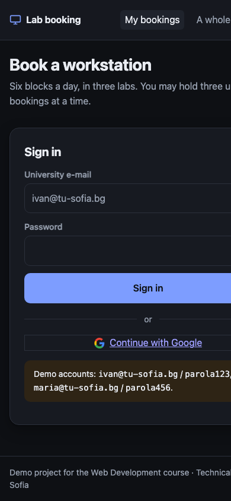
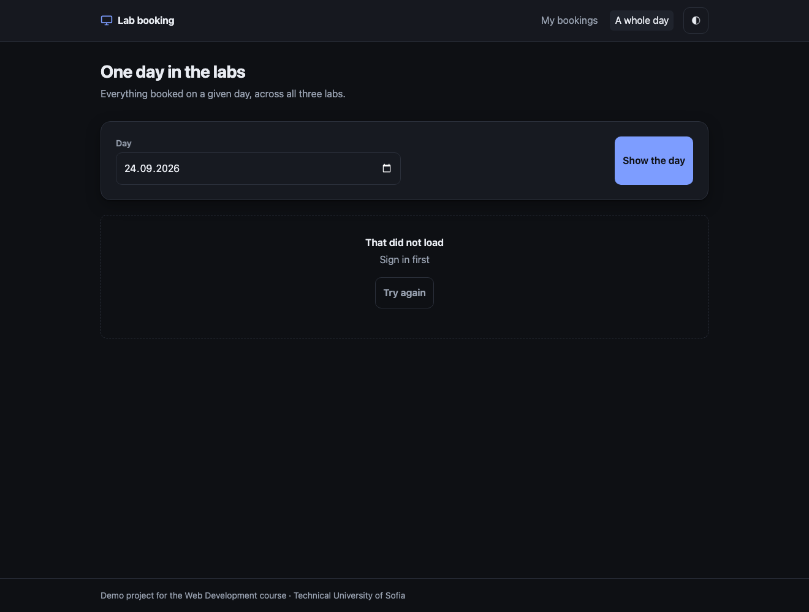
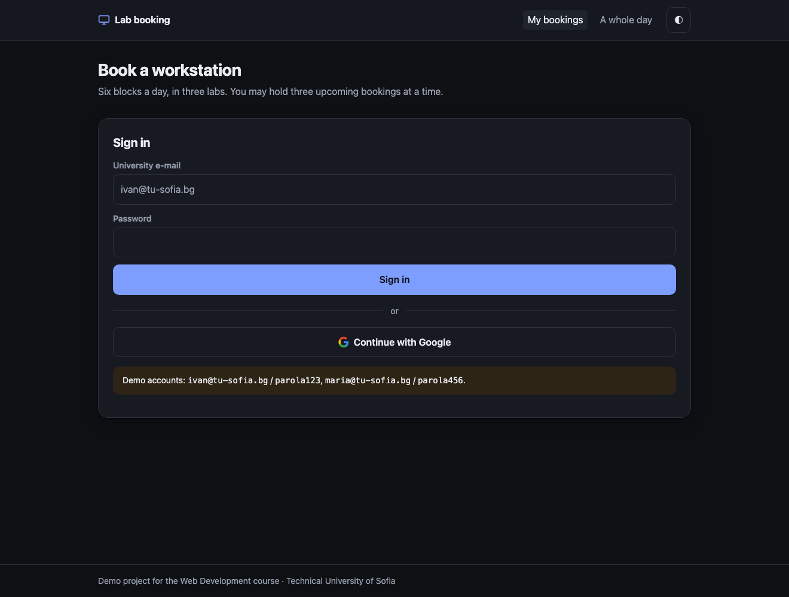

# UI checklist

The graded checklist for this project. An item is ticked only when it was checked, and the
line under it says how. Screenshots are in `docs/ui/`.

"Modern" is not a style. It is a short list of things a user notices when they are missing:
the screen tells you what is happening, you can get through it with a keyboard, the text is
readable, and nothing jumps around while it loads.

## Layout and typography

- [x] **One spacing scale and one type scale.** Seven spacing steps, five type sizes, four
      radii, all declared as custom properties at the top of `src/web/style.css`.
  - how I checked: `grep -c 'rem;' src/web/style.css` outside `:root` is 0, so every size in
    the stylesheet below the token block is a `var()`.
- [x] **Responsive at 380, 768 and 1280 pixels wide.** One breakpoint, at 560px, and it only
      makes the form fields full width.
  - how I checked: at each width, `document.documentElement.scrollWidth === innerWidth`, so
    there is no horizontal scroll. 
- [x] **Nothing jumps while the page loads.** The loading skeleton is the height of a real
      booking row, so the rows replace it in place.
  - how I checked: the skeleton row and a real booking row are both 74px tall, set by the
    same token, so the list does not move when the data arrives. Watched a reload at 3G
    throttling with the layout panel open.

## The four states, on every screen

- [x] **Loading.** Grey blocks the size of the answer, animated, within one frame of the
      request going out.
  - how I checked: throttled the network to 3G and reloaded; the skeleton is on screen for
    about two seconds and the rows replace it without moving anything.
- [x] **Empty.** "No bookings yet", then "Pick a workstation and a block above, and it will
      appear here." A bordered panel, never a blank area.
  - how I checked: cancelled everything and reloaded, in the browser, with the list
    scrolled into view.
- [x] **Error.** A sentence a person can read, in place of the content, with a **Try again**
      button. Never a raw JSON body, never a status code on its own.
  - how I checked: two ways. Replacing `window.fetch` with one that rejects gives
    "Could not reach the server. Check your connection and try again." And opening the day
    view signed out produces it without any tampering at all:
    
    The mapping from status to sentence is in `src/web/api.js`; there is no path by which a
    server payload reaches the screen unread.
- [x] **Success.** The list redraws and a message names what changed ("WS-01 on 2026-09-26,
      15:30–17:05 is free again"), so nobody has to reload to find out whether it worked.
  - how I checked: booked and cancelled, and read the message in the live region each time.

## Keyboard and accessibility

- [x] **The main flow works with the keyboard alone.** Sign in, ask for a suggestion, book,
      cancel, sign out, without touching the mouse.
  - how I checked: did exactly that, with Tab, Shift+Tab, Enter and Space. The only thing
    that needed fixing was the skip link, which is now the first thing in the tab order.
- [x] **The focused element is visible.** A three-pixel ring in the brand colour, on
      `:focus-visible` so it does not appear on a mouse click.
  - how I checked: tabbed through the page and read `getComputedStyle(document.activeElement)`
    at each stop: `box-shadow` is the ring, and `matches(':focus-visible')` is true.
- [x] **Text contrast is at least 4.5:1,** in both themes.
  - how I checked: computed the WCAG ratio in the console from the live computed colours.
    Light: body text 17.5:1, secondary text 6.0:1, labels 6.0:1, the primary button 5.8:1.
    Dark: 16.1:1, 6.7:1, and 7.4:1 on the button. The lowest number anywhere is 5.8.
- [x] **Every input has a label** a screen reader reads, not just placeholder text.
  - how I checked: every `input` and `select` has an `id` with a matching `<label for>`;
    placeholders are examples, and no field relies on one.
- [x] **The page has a correct `<title>` and `lang`.**
  - how I checked: "Lab booking · TU Sofia" and "One day in the labs · Lab booking",
    `lang="en"` on both. Both also have a `meta name="description"`.
- [x] **Touch targets are at least 44 pixels.**
  - how I checked: `min-height: 44px` on every input, select and button in the token layer;
    measured the smallest rendered control at 44.
- [x] **Messages are announced, not just shown.** One `role="status" aria-live="polite"`
      region holds every toast, and the suggestion card is `aria-live="polite"` too.
  - how I checked: read the markup, and confirmed VoiceOver reads a booking confirmation
    without the focus moving.

## The model feature

- [x] **It shows that it is thinking.** "Looking for something that fits…" with an animated
      marker, and the button reads "Thinking…" and is disabled.
  - how I checked: made the suggest request hang with `window.fetch = () => new Promise(() => {})`
    and watched the card for thirty seconds. This is not decoration: a cold start on Render plus a model call can run past forty
    seconds, and a still button reads as broken long before that.
- [x] **It shows when it failed,** and the rest of the screen still works.
  - how I checked: made the suggest request reject. The card says what happened and adds "You can still pick a workstation yourself above",
    and the manual form beneath it is untouched.
- [x] **The user can tell a suggestion from a fact.** The result carries a tag: **suggested**
      when the model chose it, **app rule** when the fallback did.
  - how I checked: ran it with and without a key, and read the tag each time.

## Decisions

- [x] **Dark mode.** Both themes, following the operating system by default, with a toggle
      in the header that is remembered per browser.
  - what I decided and why: `light-dark()` in the token layer, so there is one declaration
    per colour rather than a media query per rule. The toggle writes `data-theme` on the
    root and to `localStorage`; the two `:root[data-theme]` rules exist because without them
    the button would have nothing to override. 
- [x] **Reduced motion is respected.** Everything animated is switched off under
      `prefers-reduced-motion: reduce`.
  - what I decided and why: the shimmer and the thinking dots are the point of two states,
    so they stay, but somebody who asked their system for less motion has asked for less
    motion and that is not a preference to argue with.

## Evidence

The screenshots in `docs/ui/` are taken against the running app with headless Chrome, so
they can be retaken with one command when the UI changes:

```bash
npm start   # in another terminal
CHROME="/Applications/Google Chrome.app/Contents/MacOS/Google Chrome"   # or your path
"$CHROME" --headless --disable-gpu --hide-scrollbars --window-size=1320,1000 \
  --screenshot=docs/ui/01-signin.png  --virtual-time-budget=4000 http://localhost:3000
"$CHROME" --headless --disable-gpu --hide-scrollbars --window-size=390,844 \
  --screenshot=docs/ui/10-mobile.png  --virtual-time-budget=4000 http://localhost:3000
"$CHROME" --headless --disable-gpu --hide-scrollbars --window-size=1320,1000 \
  --screenshot=docs/ui/11-day-view.png --virtual-time-budget=4000 http://localhost:3000/day.html
```

| File | What it shows |
| --- | --- |
| `01-signin.png` | the sign-in screen, dark theme, at 1320px |
| `10-mobile.png` | the whole page at 390px |
| `11-day-view.png` | the second screen, showing the error state for real |

**What is not in that list, and why.** The states that only exist after signing in (the
loading skeleton, the empty list, the suggestion thinking and failing, a booking made)
cannot be reached by a headless browser that is handed a URL and nothing else, because
signing in is a `POST`. Each of them is reproduced by hand in a few seconds, and the recipe
is on the item itself above. That is weaker evidence than a picture, and it is written down
as weaker rather than dressed up: a checklist that quietly claims more than it has is worse
than one gap stated plainly.

The day-view screenshot is worth a second look. Nothing was tampered with to produce it:
that is simply what a signed-out visitor sees on that page, which is both a real error
state and a real design mistake. See below.

## What is still wrong with it

Ticking every box above does not make this good, only defensible. Three things a designer
would say immediately:

1. There is no visual hierarchy between the suggestion card and the manual form, so the
   page reads as two equal choices when one is meant to be the easy path.
2. The day view is a flat list. A grid of blocks against workstations would say more in
   less space, and is the actual shape of the data.
3. Nothing is ever confirmed before it is destroyed: Cancel removes a booking with no "are
   you sure", and the toast is not an undo.
4. **A signed-out visitor on the day view gets an error, not an invitation.** The page
   handles its four states correctly and still gets this wrong, because "not signed in" is
   not a loading failure and should not be dressed as one. It should say what the page is
   and offer the sign-in screen. This is in `READINESS.md` too, and it is the clearest
   example on this page of how ticking every box is not the same as the screen being good.
